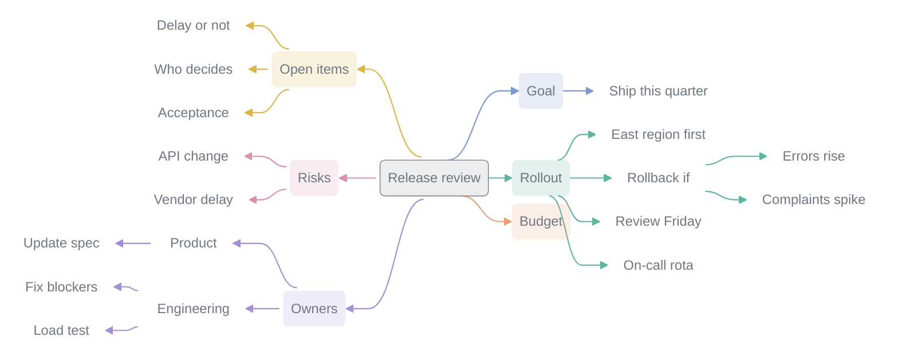

# LexVoice

Record meetings in Obsidian, follow a live outline, and get organized notes and a mind-map overview, using your own transcription and AI services, with recordings and notes saved in your vault.

 

English | [简体中文](README.zh-CN.md) · [User manual](https://lexvoice.cn/en/manual.html) · [Release notes](RELEASE_NOTES.md) · [中文文档站](https://lexvoice.cn/zh/)

A made-up example of the meeting overview.

## What it does

- Record: the microphone, system audio or both on desktop, with no virtual audio device needed on Windows; the microphone on mobile.
- Transcribe: live, after the meeting, or both. Speaker separation works where the service supports it.
- Follow along: a live outline updates as you record. During the meeting, jot notes, ask the AI a question, capture a todo, or add images and files.
- Organize: notes are generated from a template and named automatically, with a mind-map overview. Six templates are built in: General notes, Work meeting, Seminar, Interview, Personal notes and Learning notes. You can also write your own rules.
- Follow up: use **Ask** to check details against the notes and the raw transcript.
- Import: turn audio, MP4 screen recordings and text transcripts into notes, or watch a folder and import automatically.
- Reuse: people, todos, learning cards and hotwords become Markdown; notes about the same subject are gathered into topic pages.
- Share: generate an HTML report, a PDF report or an email draft.
- Recover: long recordings are processed in parts, and only unfinished parts are retried.

See the [user manual](https://lexvoice.cn/en/manual.html) for how each feature works.

## Install

From the Obsidian Community plugins directory: open **Settings → Community plugins → Browse**, search for LexVoice, then install and enable it.

Manual install:

1. Download `main.js`, `manifest.json` and `styles.css` from the same [official GitHub Release](https://github.com/Lynn-x/LexVoice/releases/latest).
2. Copy them into `<your vault>/.obsidian/plugins/lexvoice/`.
3. Reload Obsidian and enable LexVoice under Community plugins.

When updating manually, replace only these three files and keep `data.json` and your vault files.

## First recording

1. Open **Home** in LexVoice settings. Under **Quick setup**, choose a service, paste an API key and choose **Test and enable**. If you have no account, choose **Sign up**.
2. Open the LexVoice sidebar and choose a **Template** and **Audio** input.
3. Choose **New recording** and check that the level meter reacts. Fill in the name, speaker and outline in the note's **Meeting info** box, or leave it empty.
4. Watch the live outline and add in-meeting notes if needed.
5. Stop recording, then click the LexVoice status in the status bar to open the task center and follow transcription and AI organization. If processing was interrupted, continue from where it stopped.
6. Open **Knowledge**, choose **Scan this note**, and review people, todos, learning cards and hotwords.
7. To share, right-click a note in the **Notes** list, choose **Generate**, then an HTML report, PDF report or email draft.

Recordings go to `LexVoice/录音` and notes to `LexVoice/转写纪要` by default. Both can be changed in settings.

## What's new in 3.0.0

- Sidebar: rebuilt. The home view, outline, notes list, Ask, Knowledge and import share one type scale and spacing, and sub-pages have a back control.
- Task center: replaces the pending queue window. Meetings can be stopped, continued, retried, abandoned and restored there, and finished history can be cleared.
- Meeting info: new recording notes start with a **Meeting info** box. What you fill in sets the file name and the second-level headings of the notes.
- Handwritten notes: text you type above or below the transcript area while recording is kept in a collapsed callout in the raw materials. Text written between transcript segments, or while continuing a recording, is overwritten.
- Meeting overview: top-level topics follow the sections of the notes, each topic has its own color, and every section with content gets at least one point. **Generate overview** is at the top level of the right-click menu.
- Fast model: outlines and overviews can use a lighter model on the same connection, while notes and reports keep the main one.
- Long recordings and large files: multi-hour recordings are processed in blocks, and Xiaomi MiMo accepts files of up to 8 hours. On desktop, MP4 video imports use only the audio track.

Update every device that syncs the same vault before resuming unfinished transcriptions. See the [release notes](RELEASE_NOTES.md).

## Requirements

- Obsidian 1.10.0 or later.
- A speech-to-text service, cloud API or local.
- An AI service is recommended: the live outline, organized notes, the overview, knowledge extraction and reports all use it.
- A virtual audio device to record system audio on macOS or Linux.

| Use | Services |
|---|---|
| Transcription and AI | SiliconFlow, Alibaba Cloud Bailian, OpenAI, Xiaomi MiMo |
| AI only | DeepSeek, Moonshot / Kimi, Zhipu GLM, Volcengine Ark, Tencent Hunyuan, MiniMax, Baidu Qianfan, OpenRouter, Google Gemini and others |
| Local | A local transcription service, Ollama, LM Studio, a local OpenAI-compatible service |
| Custom | Any OpenAI-compatible AI service |

To use different services for different tasks, add them under **Model services**, then choose them in **Transcription & AI**.

The interface follows Obsidian's language and is available in Chinese, English and Japanese.

## Privacy

No ads, no analytics, no telemetry, and no LexVoice server. Settings are stored in `.obsidian/plugins/lexvoice/data.json`; recordings and notes stay in your vault.

With a cloud service, the relevant audio, transcript text and prompt context are sent to the provider you chose. For sensitive content, prefer local transcription and a local model, and obtain consent before recording.

- Anything in the **Meeting info** box is always sent to the configured AI service, and to the transcription service if it accepts prompts. Leave it empty to send nothing from it.
- Preparation material is sent only after **Use for transcription & AI** is on. Turning it off does not recall requests already sent.
- Handwritten notes are not sent to AI when generating notes, overviews or reports; knowledge scans and AI polish on a whole note do read them.
- **Automatic links and meeting topics** is on by default. Background analysis may incur provider charges; it does not additionally send audio, paths or full verbatim transcripts. Turning it off does not undo content already written.

See [`PRIVACY.md`](PRIVACY.md) for details.

## FAQ

Do I need my own API keys?

Yes. LexVoice ships no keys and has no account.

Does it work on mobile?

Yes. Mobile recording uses the device microphone. Keep Obsidian in the foreground, because locking the screen or switching apps may interrupt recording. System audio, virtual audio devices, multichannel capture, device tests, streaming live transcription and PDF reports require desktop.

How do I record system audio?

Windows: under **Audio**, choose **Microphone + Windows system audio (recommended)**, or **Windows system audio only** for video and courses. If the direct test fails, use VB-Cable.

macOS: use BlackHole. Linux: use a PulseAudio / PipeWire monitor source.

Before a long recording, run **Test devices** in **Settings → Advanced → Audio input** and play some audio during the test to confirm sound.

Which files can I import?

Audio in MP3, WAV, M4A, AAC, WebM, Ogg, FLAC and similar formats, plus Markdown and TXT. On desktop, MP4 video uses only its audio track. WebM video and most files over 1 GB are refused with an explanation.

Can I use a Coding Plan or Token Plan?

Several providers have these built in. Open a connection in **Model services** to switch billing. Most plans offer AI organization only, not transcription. The terms of many plans prohibit use from apps like LexVoice, so check yours first.

What if something goes wrong?

Run **Copy diagnostic report** and send it to the developer. The report has no audio, transcript text or full prompts, and common API keys, user folders and vault paths are hidden automatically. See the [user manual](https://lexvoice.cn/en/manual.html) for troubleshooting.

## License & credits

Beginning with the 2.2.0 release line, new LexVoice material is distributed under the [LexVoice Proprietary Software License](LICENSE). Development source code is no longer publicly released. Official JavaScript runtime files remain inspectable; that does not make this an open-source release or grant a right to redistribute the runtime or source code.

Personal and internal business use is permitted. Your recordings, notes, and exported reports may still be edited, shared, and commercially used, subject to rights in their contents. Unauthorized rebranding, repackaging, external redistribution (free or paid), resale, and white-label software offerings are prohibited. Local adjustments for your own permitted use are allowed; distributing a modified plugin is not.

Previously MIT-licensed releases, including 2.1.2, and previously MIT-licensed portions reused in later releases retain their original rights. See [the preserved MIT notice](licenses/LEXVOICE-LEGACY-MIT.txt). Third-party components retain their own licenses; see [Third-Party Notices](THIRD_PARTY_NOTICES.md). Nothing here restricts mandatory legal rights or independent implementations of general ideas.

Closed-source distribution through the Obsidian community directory is subject to [Obsidian's case-by-case review](https://docs.obsidian.md/community-directory/developer-policies). This license change does not itself establish approval for the new distribution model.

The HTML slide-deck feature in earlier versions was inspired by [alchaincyf/huashu-design](https://github.com/alchaincyf/huashu-design); its HTML-first slide workflow and design principles influenced that work. Per the upstream license: Derived from alchaincyf/huashu-design.
