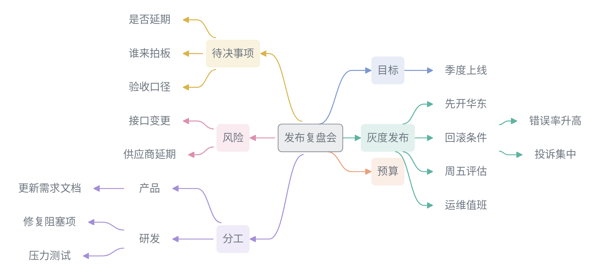

<picture>
  <source media="(prefers-color-scheme: dark)" srcset="./assets/brand/logo-mark-reverse.svg">
  <source media="(prefers-color-scheme: light)" srcset="./assets/brand/logo-mark.svg">
  
</picture>

# LexVoice

在 Obsidian 里录会议，边录边看实时大纲，会后得到纪要和思维导图概览；转写和 AI 用你自己的服务，录音和纪要存在你的知识库。

[English](README.md) | **简体中文** · [版本说明](RELEASE_NOTES.md)

会议概览示例（虚构会议）。

## 能做什么

- 录音：桌面端录麦克风、电脑声音或两者一起，Windows 不用装虚拟声卡；移动端录麦克风。
- 转写：实时、会后或两者都做。服务支持时可以区分说话人。
- 边录边看：实时大纲随录音更新，会中可以随手记、向 AI 提问、记待办、添加图片和文件。
- 整理：按模板生成纪要并自动命名，再画一张思维导图概览。内置综合纪要、工作纪要、研讨会、访谈、个人笔记和学习笔记六种模板，也可以写自己的规则。
- 追问：用「问一问」对照纪要和原始转写核对细节。
- 导入：音频、MP4 录屏和文字稿都能整理成纪要，也可以监听文件夹自动导入。
- 沉淀：人员、待办、学习卡片和热词存成 Markdown；讨论同一件事的多篇纪要聚合成主题页。
- 分享：生成 HTML 报告、PDF 报告或邮件草稿。
- 恢复：长录音分段处理，出错时只重试没完成的部分。

各功能的用法见[用户手册](https://lexvoice.cn/zh/manual.html)。

## 安装

从 Obsidian 社区插件目录安装：打开「设置 → 第三方插件 → 浏览」，搜索 LexVoice，安装并启用。

手动安装：

1. 从同一个[官方 GitHub Release](https://github.com/Lynn-x/LexVoice/releases/latest) 下载 `main.js`、`manifest.json` 和 `styles.css`。
2. 放入 `<你的知识库>/.obsidian/plugins/lexvoice/`。
3. 重新加载 Obsidian，在第三方插件中启用 LexVoice。

手动更新时只替换这三个文件，保留 `data.json` 和知识库文件。

## 第一次录音

1. 打开 LexVoice 设置的「首页」，在「快速开始」选一家服务，粘贴 API 密钥，点「测试并启用」。没有账号时点「去开通」。
2. 打开 LexVoice 侧边栏，选「模板」和「音频」。
3. 点「新建录音」，确认电平条随声音变化。新笔记的「会议信息」框可以填会议名称、发言人和大纲，不填也能用。
4. 看实时大纲，需要时添加会中补充。
5. 停止录音，点状态栏的 LexVoice 状态打开任务中心，看转写和 AI 整理进度。处理中断时，从没完成的地方继续。
6. 打开「沉淀」，点「扫描本篇」，确认人员、待办、学习卡片和热词。
7. 需要分享时，在「纪要」列表右键选「生成」，再选 HTML 报告、PDF 报告或邮件草稿。

录音默认存在 `LexVoice/录音`，纪要存在 `LexVoice/转写纪要`，都可以在设置中修改。

## 3.1.0 更新重点

- 中断后保留已完成进度，下次打开继续未完成部分；手动暂停的任务保持暂停。
- 一场会议一张任务卡，集中处理语音转写与纪要整理。点击转写主行，查看最近成功的一段及全部失败片段，只重试未完成内容。
- 可以自动转写、手动整理，也可以按会议保存的设置自动衔接整理。
- 放弃后进入历史；清除历史列表保留原材料和暂存结果，已放弃任务不再计入重试提示。
- 状态图标跟随主题，历史可堆叠展开，卡片换组连续移动。
- 整理时结合上下文消除 ASR 与口语噪声，不再要求逐词核对。
- 支持多选纪要合并整理，原笔记保留；MiMo 分段衔接减少丢字，侧栏吸顶条跟随面板背景。

## 使用要求

- Obsidian 1.10.0 或更高版本。
- 一个语音转写服务，云端 API 或本地服务都可以。
- 建议配一个 AI 整理服务：实时大纲、纪要整理、概览、沉淀和报告都要用到它。
- 在 macOS、Linux 上录电脑声音，需要虚拟音频设备。

| 用途 | 服务 |
|---|---|
| 转写与整理 | 硅基流动、阿里云百炼、OpenAI、小米 MiMo |
| 仅 AI 整理 | DeepSeek、Moonshot / Kimi、智谱 GLM、火山方舟、腾讯混元、MiniMax、百度千帆、OpenRouter、Google Gemini 等 |
| 本地 | 本地转写服务、Ollama、LM Studio、本地 OpenAI 兼容服务 |
| 自定义 | 任何 OpenAI 兼容的 AI 服务 |

不同任务用不同服务时，到「模型服务」添加供应商，再到「转写与整理」分别选择。

界面语言跟随 Obsidian，支持中文、英文和日语。

## 隐私

没有广告、行为分析或遥测，也没有 LexVoice 自己的服务器。设置存在 `.obsidian/plugins/lexvoice/data.json`，录音和纪要存在你的知识库。

使用云端服务时，相关音频、转写文本和提示词上下文会发给你选择的服务商。敏感内容建议用本地转写和本地模型，并在录音前取得相关人员同意。

- 「会议信息」框里填的内容总会发给配置的 AI 服务，能接收提示的转写服务也会收到。不填就不发。
- 会前材料要开启「用于转写与整理」才会发送。关闭不撤回已发出的请求。
- 手写笔记在生成纪要、概览、报告时不发给 AI；沉淀扫描和对整篇做 AI 润色会读到它。
- 「自动双链与会议主题」默认开启，后台分析可能产生服务商费用，不额外发送音频、路径或完整逐字稿。关闭后不撤回已生成的内容。

详情见[隐私说明](PRIVACY.md)。

## 常见问题

需要自己准备 API Key 吗？

需要。LexVoice 不内置密钥，也没有账号。

手机上能用吗？

能。移动端录设备麦克风，录音时保持 Obsidian 在前台，锁屏或切后台可能中断录音。电脑音频、虚拟声卡、多声道采集、设备检测、流式实时转写和 PDF 报告需要桌面端。

怎么录电脑声音？

Windows：在「音频」里选「麦克风 + Windows 系统音频（推荐）」，录视频或课程选「仅 Windows 系统音频」。直接采集的测试失败时改用 VB-Cable。

macOS 用 BlackHole，Linux 用 PulseAudio / PipeWire monitor source。

长时间录音前，在「设置 → 进阶 → 音频输入」点「测试设备」，测试时放一段音频确认有声。

可以导入哪些文件？

音频支持 MP3、WAV、M4A、AAC、WebM、Ogg、FLAC 等格式，文本支持 Markdown 和 TXT。桌面端导入 MP4 视频只取音轨。WebM 视频和大多数超过 1 GB 的文件会说明原因并拒绝。

可以用 Coding Plan 或 Token Plan 吗？

多家服务商已内置，在「模型服务」点开连接切换计费方式。大多数套餐只能用于 AI 整理，不能转写。许多套餐的条款禁止在 LexVoice 这类应用中使用，使用前请确认。

出问题了怎么办？

运行命令「复制诊断报告」发给开发者。报告不含音频、转写正文和提示词全文，常见的 API Key、用户目录和知识库路径会自动隐藏。排错步骤见[用户手册](https://lexvoice.cn/zh/manual.html)。

## 许可证与致谢

自 2.2.0 版本线起，新增的 LexVoice 内容采用 [LexVoice 专有软件许可](LICENSE)，后续开发源码不再公开。安装所需的 JavaScript 运行文件仍可查看；这不属于开源发布，也不授予对运行文件或源码的再发布权。

允许个人和企业内部正常使用。用户自己的录音、纪要和导出报告可以继续编辑、分享和商用，但需遵守内容本身的权利及第三方服务条款。未经书面授权，不得将插件改名包装、对外重新发布（包括免费发布）、售卖或作为贴牌软件提供。本地自用调整不受禁止，对外分发修改版则需要授权。

包括 2.1.2 在内的既有 MIT 版本，以及新版中沿用的既有 MIT 部分，保留原有授权，见 [历史 MIT 声明](licenses/LEXVOICE-LEGACY-MIT.txt)。第三方组件继续适用各自的许可证，见 [第三方声明](THIRD_PARTY_NOTICES.md)。新许可不限制法律强制保留的权利，也不禁止独立实现一般思路或功能。

闭源版本通过 Obsidian 社区目录分发需遵守其[个案审核政策](https://docs.obsidian.md/community-directory/developer-policies)；更换许可本身不代表这种分发方式已经获得认可。

早期版本的 HTML 幻灯片功能受到 [alchaincyf/huashu-design](https://github.com/alchaincyf/huashu-design) 的启发，其 HTML-first 工作流和设计原则影响了该功能的实现。根据上游许可证说明：Derived from alchaincyf/huashu-design.
